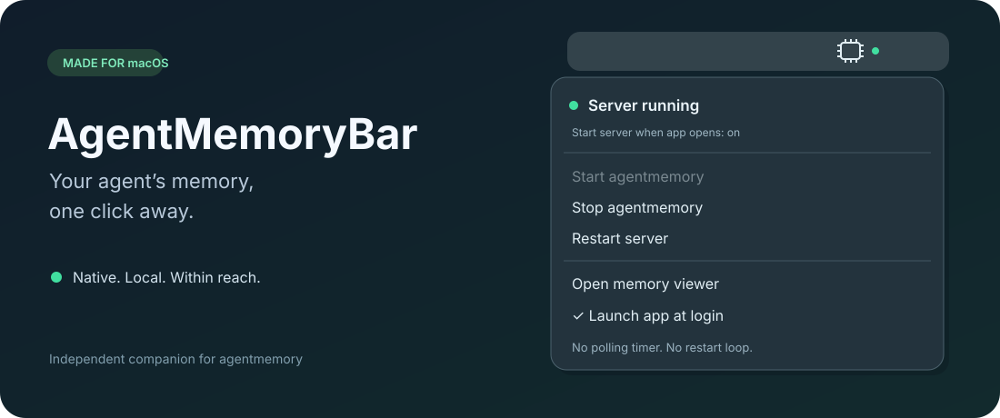

<p align="center">
  
</p>

<p align="center">
  <strong>A small macOS menu bar companion for <a href="https://github.com/rohitg00/agentmemory">agentmemory</a>.</strong><br>
  See whether your memory server is running. Start it, stop it, and get back to work.
</p>

<p align="center">
  
  
  
  <a href="LICENSE"></a>
</p>

<p align="center"><a href="#install">Install</a> · <a href="#everyday-use">Everyday use</a> · <a href="#build-from-source">Build</a> · <a href="docs/RELEASING.md">Release guide</a> · <a href="docs/README.ru.md">Русский</a></p>

## Your memory server, within reach

| Feature | What it does |
| --- | --- |
| Status at a glance | Green means healthy, gray means stopped, orange means busy, red means attention is needed. |
| Start, stop, restart | Uses the official agentmemory CLI and checks authenticated REST health. |
| One login entry | macOS opens AgentMemoryBar; the app starts agentmemory when enabled. |
| Remember your choice | Stopping the server disables starting it when the app next opens. The icon can still launch at login. |
| Open the viewer | Jump straight to your memories at `http://localhost:3113`. |
| Event-driven status | Refreshes on menu open, runtime metadata changes, process exit, and wake. No minute timer or automatic recovery loop. |

AgentMemoryBar is an independent companion. **[agentmemory](https://github.com/rohitg00/agentmemory)** provides the memory store, MCP tools, capture integrations, and web viewer. Install and configure agentmemory separately; this app manages its local lifecycle.

## Install

**Requires macOS 13+, Node.js 20+, and an initialized agentmemory installation.**

1. Set up agentmemory using its [installation guide](https://github.com/rohitg00/agentmemory#install). Complete its setup before opening this app.
2. Download the DMG from this repository's **Releases** page.
3. Open the DMG and drag **AgentMemoryBar.app** into **Applications**. Eject the disk image.
4. Open the app from Applications. Look for the memory chip in your menu bar.
5. Select **Launch app at login** if you want it to open after signing in.

The first release uses an ad-hoc signature unless the maintainer supplies Developer ID credentials. For a downloaded build that macOS blocks, use **System Settings → Privacy & Security → Open Anyway** after reviewing the source and verifying the checksum. No system-wide security changes are needed. See [Apple's instructions](https://support.apple.com/en-us/102445).

### Finding your installation

The app checks `/opt/homebrew/bin/agentmemory`, then `/usr/local/bin/agentmemory`. It also recognizes the earlier pinned `~/.agentmemory/runtime-0.9.33` installation.

If you use nvm, fnm, Volta, or a custom installation, open **Settings…**:

- **Executable:** the absolute path to `agentmemory`, or to `node`.
- **CLI .mjs:** leave empty for a directly executable `agentmemory` command; otherwise enter the absolute path to its `dist/cli.mjs` file.
- **Data directory:** the existing agentmemory data directory. Stop the server before changing it.

Use full paths: apps launched at login do not inherit your interactive shell setup. AgentMemoryBar does not run shell initialization files or install packages on your behalf.

## Everyday use

| Menu item | Effect |
| --- | --- |
| Start agentmemory | Starts the server and remembers to start it when the app opens again. |
| Stop agentmemory | Stops the server and remembers to leave it stopped on the next app launch. |
| Restart server | Performs a normal stop and start. |
| Launch app at login | Controls only the menu bar app's login entry. |
| Open memory viewer | Opens agentmemory's existing web UI. |
| Refresh status | Performs a fresh health check. |
| Open logs… | Opens AgentMemoryBar's support folder. |
| Quit AgentMemoryBar | Removes the icon. **The server keeps running.** Stop it first if desired. |

On login: **macOS → AgentMemoryBar → agentmemory**. There is no separate server login job, periodic restart, or crash recovery service. If startup fails, the icon reports an error; inspect the logs and retry explicitly.

Stopping the server does not remove memory, disable client hooks, or stop their offline queues. Configure those in agentmemory and each coding agent.

### Command line

The same controller is available to scripts without starting the menu UI:

```sh
"/Applications/AgentMemoryBar.app/Contents/MacOS/AgentMemoryBar" --control status
"/Applications/AgentMemoryBar.app/Contents/MacOS/AgentMemoryBar" --control on
"/Applications/AgentMemoryBar.app/Contents/MacOS/AgentMemoryBar" --control off
```

Actions: `status`, `on`, `off`, `restart`, `login`, `login-on`, `login-off`. `login` respects the saved server preference. Commands print JSON and return a nonzero exit code on failure. `on` controls the server preference; app launch at login remains an independent choice.

## Privacy and scope

- No analytics, accounts, or background update checks.
- Communicates only with the local REST API on port **3111**; opens the viewer on **3113**.
- Reads agentmemory's existing local authentication secret. It does not print or copy it into app settings. HTTP redirects are refused.
- Uses the official CLI for process control. An ownership check prevents stopping an instance with a different data directory.
- This version supports the default local Compose instance only. Custom ports, remote servers, Docker deployments, and multiple instances are outside its scope.
- Tested with agentmemory **0.9.33** on Apple Silicon. The Intel slice is built but still needs runtime testing on an Intel Mac. Upstream CLI/state changes may require an app update.

App settings and logs live in `~/Library/Application Support/AgentMemoryBar/`. The optional login entry is `~/Library/LaunchAgents/local.agentmemorybar.plist`. agentmemory keeps its own configuration and data in their existing locations.

## Build from source

Requires Xcode Command Line Tools (`xcode-select --install`). No third-party app dependencies, Python, npm, or Xcode project is needed to build the menu bar app.

```sh
cd agentmemorybar
bash scripts/test.sh
bash scripts/build.sh         # universal: arm64 + x86_64
bash scripts/dmg.sh           # DMG + SHA256SUMS in build/
open build/AgentMemoryBar.app
```

For a single architecture: `ARCH=arm64 bash scripts/build.sh` or `ARCH=x86_64 bash scripts/build.sh`.

The build is ad-hoc signed by default. Developer ID signing and notarization are optional; see [the release guide](docs/RELEASING.md). GitHub Actions tests builds on pull requests and creates a **draft release with a DMG** when you push a version tag.

## Uninstall

Stop the server if desired. Uncheck **Launch app at login**, quit the app, and delete it from Applications. You may then remove `~/Library/Application Support/AgentMemoryBar/`. Your agentmemory installation and stored memories remain intact.

## Contributing

Small, focused pull requests are welcome. Include macOS version, CPU architecture, agentmemory version, and reproduction steps when reporting an issue. Redact secrets and session content from logs. See [CONTRIBUTING.md](CONTRIBUTING.md).

## Credits & license

Built for **[rohitg00/agentmemory](https://github.com/rohitg00/agentmemory)**. AgentMemoryBar is an independent project and is not an official agentmemory release. agentmemory is installed separately and is not bundled in the DMG.

AgentMemoryBar is released under the [MIT License](LICENSE).
